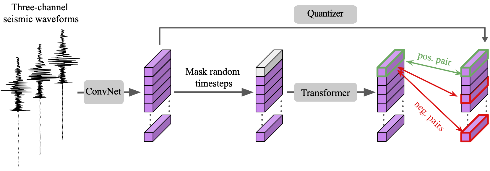

# SeisLM: A Foundation Model for Seismic Waveforms

SeisLM learns representations of three-component seismic waveforms. This repository contains the pretrained encoders and the original research code for pretraining and downstream experiments described in the [paper](https://arxiv.org/abs/2410.15765).



Start with the two practitioner notebooks below to extract pretrained features and explore their structure. An encoder checkpoint does not contain a trained phase-picking head: these features are not P/S probabilities or earthquake detections. The original phase-picking experiments remain research code.

## Quickstart

Use Python 3.11–3.13 and [uv](https://docs.astral.sh/uv/getting-started/installation/):

```bash
git clone https://github.com/liutianlin0121/seisLM.git
cd seisLM
uv sync --locked
```

Download the portable base model and run a small inference example:

```bash
uv run --locked python examples/quickstart.py --checkpoint base --revision a9e9f79af940a3ea28a49ef9fa495ae89b48d576
```

The example downloads and caches the weights and configuration from the same pinned Hugging Face revision, creates a deterministic synthetic waveform, normalizes it, and reports the extracted feature shape. It uses a GPU when available and falls back to CPU. The portable model uses safetensors and does not require loading the original checkpoint's Python serialization. This is an installation smoke check; use real, suitably preprocessed data to assess scientific performance.

```python
import torch
from seisLM import encode, load_pretrained

model = load_pretrained(
    "base", revision="a9e9f79af940a3ea28a49ef9fa495ae89b48d576", device="cpu"
)
waveforms = torch.randn(1, 3, 3001, dtype=torch.float32)  # example only
waveforms = waveforms - waveforms.mean(dim=-1, keepdim=True)
std = waveforms.std(dim=-1, correction=0, keepdim=True)
std = torch.where(std == 0, torch.ones_like(std), std)
waveforms = waveforms / (std + 1e-10)
features = encode(model, waveforms)
# features: [batch, reduced_time, hidden_size]
```

See [installation and input conventions](docs/installation.md) for a standalone wheel installation, supported environments, local/offline loading, and the full input contract. See [Hugging Face releases and checkpoint export](docs/huggingface.md) for artifact contents and provenance.

## Pretrained model catalog

| Model | Encoder layers | Hidden size | Parameters in released pretraining model | Hugging Face | Original checkpoint |
|---|---:|---:|---:|---|---|
| Base | 6 | 240 | 11,359,568 | [ltlltl2006/seislm-base](https://huggingface.co/ltlltl2006/seislm-base/tree/a9e9f79af940a3ea28a49ef9fa495ae89b48d576) | [Google Drive](https://drive.google.com/file/d/12L2Js1DIXCIxacQJ4K0hRKJ6qHFrQ7K-/view) |
| Large | 12 | 768 | 90,683,648 | [ltlltl2006/seislm-large](https://huggingface.co/ltlltl2006/seislm-large/tree/3ad2a723faeded0ca45b555c9c0ea8823affcc4f) | [Google Drive](https://drive.google.com/file/d/1LPUCltHsle4OqDPGEtcHPdoRnLppY-KH/view) |

Both models are available as portable Hub bundles under the MIT license. The loading API accepts the catalog aliases `"base"` and `"large"`, full Hub repository IDs, and local bundles. Parameter counts include the pretraining heads; `encode()` returns contextual encoder features. Pin a revision, as above, when reproducing a result.

## Examples

| Notebook | What you will do |
|---|---|
| [1. Pretrained inference](examples/demo_pretrained_inference.ipynb) · [Colab](https://colab.research.google.com/drive/18dqsNcNsF9Kc9D53YPIVJMEjW_JX1ox7) | Load a real ObsPy waveform, compare the input and contextual features, and export the results |
| [2. Visualize pretrained features](examples/demo_seislm_visualized_pretrained_features.ipynb) · [Colab](https://colab.research.google.com/drive/150HS1pyoY4FLnVRksc9E9Bw4UI2q7NtQ) | Compare pretrained and randomly initialized embeddings using t-SNE; hover over a point to inspect its waveform |

Open the up-to-date hosted demos using the Colab links above. Choose a **Python 3** runtime; a GPU is recommended. Both notebooks install the public SeisLM wheel and load pinned Hugging Face encoders, without a repository clone, model login, W&B account, or legacy checkpoint. See [notebook execution and Colab checks](docs/notebooks.md) for data downloads, expected outputs, and validation records.

Execute the same notebook locally in a fresh kernel:

```bash
uv run --locked --group notebook python scripts/run_notebook.py --model base --device cpu --output-dir .artifacts/notebooks/base-cpu
uv run --locked --group notebook python scripts/run_notebook.py --model base --device cuda --output-dir .artifacts/notebooks/base-cuda
```

Use `--model large` for the large encoder. Select the feature-visualization notebook with `--notebook` and include `--extra notebooks`:

```bash
uv run --locked --extra notebooks --group notebook python scripts/run_notebook.py --notebook examples/demo_seislm_visualized_pretrained_features.ipynb --model base --device cuda --output-dir .artifacts/notebooks/features-base-cuda
```

The runner saves an executed notebook, exported results, and a machine-readable report. Local locked runs skip the installation cell. The `notebook` dependency group supplies inference and execution dependencies; the `notebooks` extra adds the dependencies needed by the feature-visualization example.

## Development and regression checks

```bash
uv sync --locked --group dev --group notebook
uv run --locked --group dev --group notebook pytest tests
```

Regression checks distinguish preservation of existing model outputs from reproduction of paper benchmarks. See [regression validation](docs/regression.md) for the tested checkpoints, devices, tolerances, and any benchmark limitations. Install the optional training and notebook dependencies when developing those workflows:

```bash
uv sync --locked --extra training --extra notebooks --group dev --group notebook
```

`uv` is the maintained environment workflow. The package still uses standard Python metadata and wheels, so downstream users can also install it with pip; no second hand-maintained pip environment is required. PyPI publication is a separate release step.
